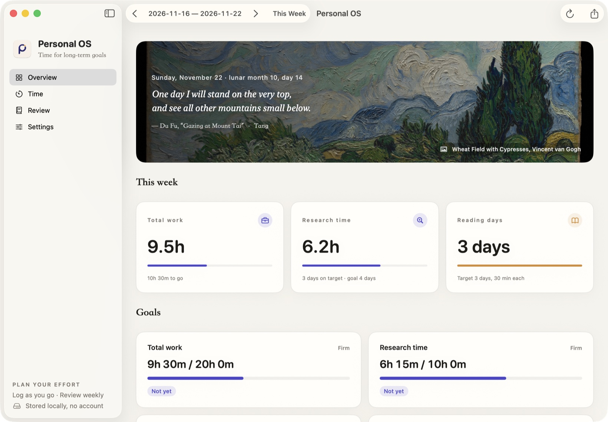
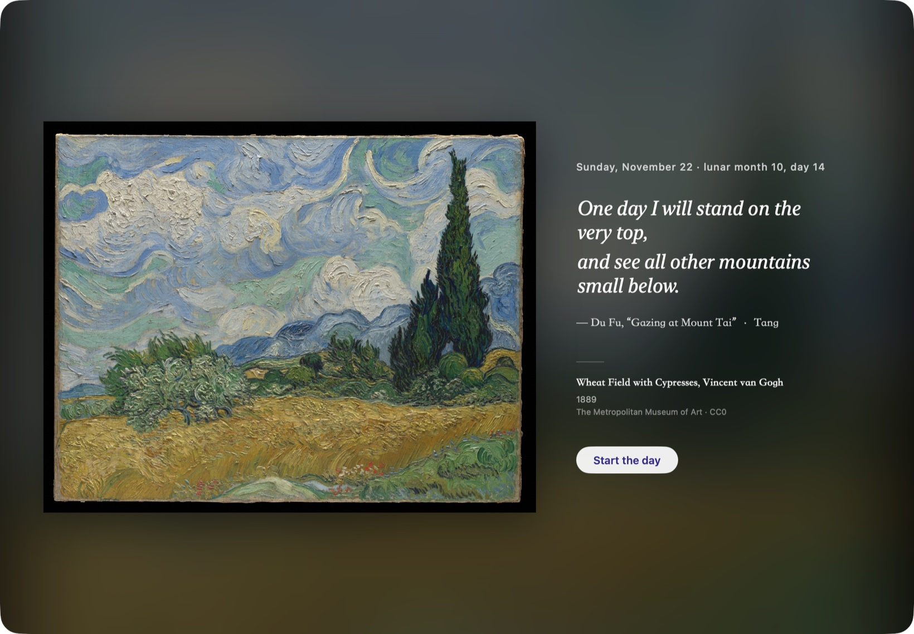
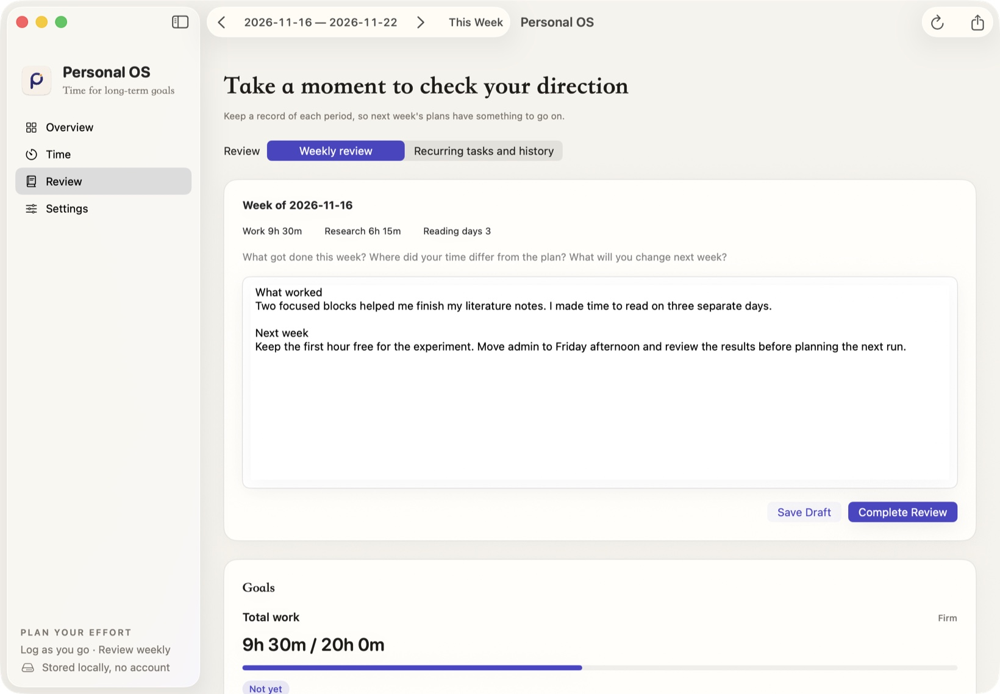

<p align="center"></p>
<h1 align="center">Personal OS</h1>
<p align="center"><strong>Track your time and review your progress, week by week.</strong></p>
<p align="center">
  <a href="https://github.com/Jiaxin2006/personal-os/releases/latest/download/Personal-OS-macos-arm64.zip"><strong>Download for macOS</strong></a>
  · <a href="https://github.com/Jiaxin2006/personal-os/releases/latest">Release notes</a>
  · <a href="README.md">Chinese</a>
</p>
<p align="center">Apple silicon · macOS 13+ · Runs locally</p>



## See it in action

The overview puts weekly hours, qualifying days, and goal progress on one screen. The two views below show the daily opening and a weekly review alongside its totals. All records shown are sample data.

| Daily opening | Weekly review |
| --- | --- |
| [](docs/demo/opening-en.jpg) | [](docs/demo/review-en.jpg) |

## Highlights

- **Track time and fill in gaps** with a timer in the window or menu bar and manual entries for anything you missed.
- **Set measurable weekly goals** by tracking hours and qualifying days separately.
- **Keep recurring tasks in view** by scheduling weekly, monthly, or quarterly reminders.
- **Review your week alongside the numbers** and revisit the goals and progress saved with each review.
- **Start the day with art and a poem** from an offline rotation of 30 Open Access works from The Met and seasonal Chinese poetry.
- **Keep your data on your Mac** with full backup and restore for time records and reviews, no account required.

## Download and install

1. Download `Personal-OS-macos-arm64.zip` from [GitHub Releases](https://github.com/Jiaxin2006/personal-os/releases/latest). Requires an Apple silicon Mac running macOS 13 or later.
2. Unzip the download, move `Personal OS.app` to Applications, and open it. Python is included.
3. This build is ad-hoc signed and has not been notarized by Apple. If macOS cannot verify the developer, try opening the app, then use **System Settings → Privacy & Security → Open Anyway**. [Apple installation guidance](https://support.apple.com/en-us/102445)

In **Settings → App language**, choose **System**, **简体中文**, or **English**, then quit and reopen Personal OS.

## Build from source

```sh
python3 -m unittest discover -s tests -v
python3 tools/fetch_python.py
python3 tools/build_macos.py
```

The SwiftUI app runs its Python and SQLite backend locally. The build downloads missing public-domain paintings and caches them in the Git-ignored `assets/paintings/` directory.

- [Usage, build instructions, and local gallery (Chinese)](docs/usage.md)
- [Components and interfaces (Chinese)](docs/agent-contract.md)

### Optional SketchyBar integration

A compatible SketchyBar timer can share `~/.config/sketchybar/data/focus.sqlite3` with Personal OS. Keep its engine in sync with `plugins/timer.py`. Personal OS supplies the timer's menu bar category labels and manual time entries for daily and weekly totals.
