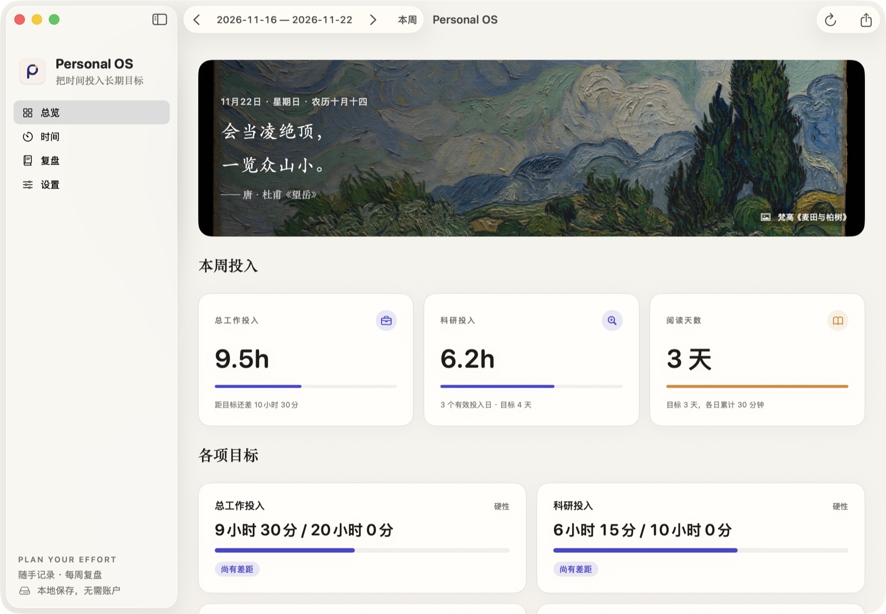
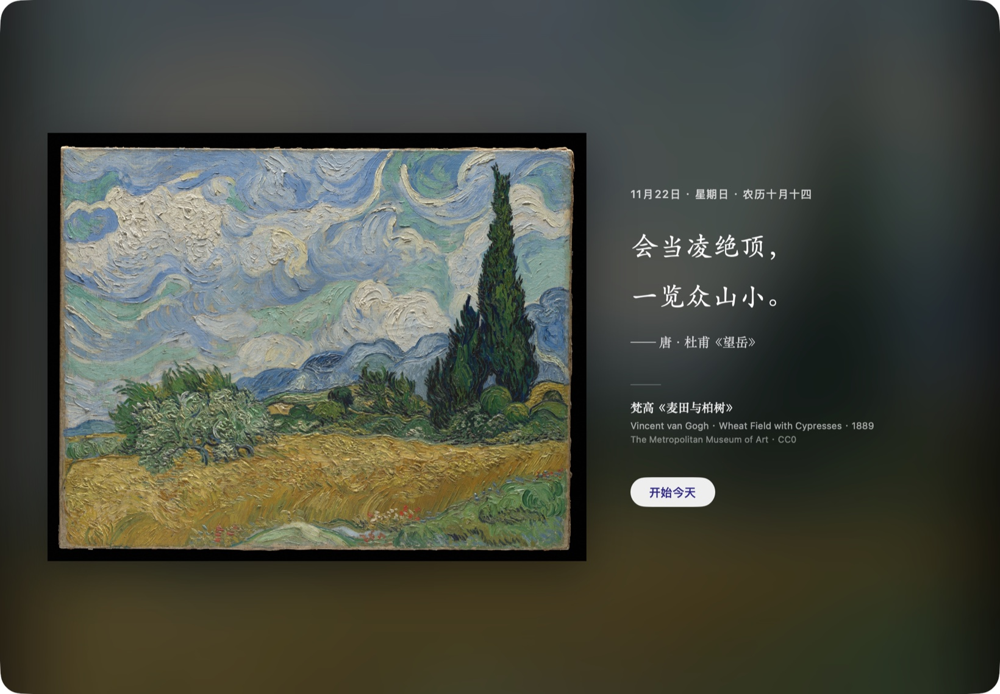
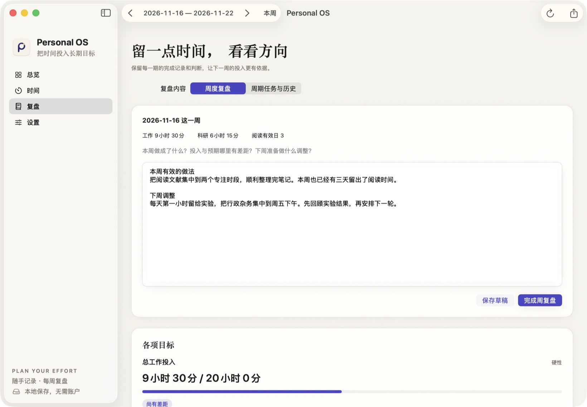

<p align="center"></p>
<h1 align="center">Personal OS</h1>
<p align="center"><strong>记录每天的投入，用一周回看进展。</strong></p>
<p align="center">
  <a href="https://github.com/Jiaxin2006/personal-os/releases/latest/download/Personal-OS-macos-arm64.zip"><strong>下载 macOS 版</strong></a>
  · <a href="https://github.com/Jiaxin2006/personal-os/releases/latest">版本说明</a>
  · <a href="README.en.md">English</a>
</p>
<p align="center">Apple 芯片 · macOS 13+ · 在本机运行</p>



## 实机演示

总览将一周的投入时长、有效天数和目标进度放在同一屏。下面两张图展示每天的诗画开场，以及可以对照数据撰写的周复盘。画面使用示例数据。

| 每日诗画 | 周度复盘 |
| --- | --- |
| [](docs/demo/opening-zh-Hans.jpg) | [](docs/demo/review-zh-Hans.jpg) |

## 核心功能

- **一键计时，随时补记**，在窗口或菜单栏记录活动，忘记开计时也能事后补上。
- **量化每周目标**，分别追踪投入时长与达标天数，看清做了多久、做得有多规律。
- **按时看到周期任务**，每周、每月或每季度的事项会在提醒窗口自动进入待办。
- **对照数据写周复盘**，连同当周的目标和进度一起保存，方便以后回看。
- **每天看一幅画、读一句诗**，30 幅大都会开放馆藏作品与应季诗词随应用离线轮播。
- **数据留在本机**，无需账户即可把时间记录和复盘完整备份、导出和恢复。

## 下载与使用

1. 从 [GitHub Releases](https://github.com/Jiaxin2006/personal-os/releases/latest) 下载 `Personal-OS-macos-arm64.zip`。需要 Apple 芯片 Mac 和 macOS 13 或更新版本。
2. 解压，将 `Personal OS.app` 拖到「应用程序」，然后打开。应用自带 Python。
3. 此版本采用临时签名，未经过 Apple 公证。若 macOS 提示无法验证开发者，可在尝试打开后前往「系统设置 → 隐私与安全性 → 仍要打开」。[Apple 安装说明](https://support.apple.com/zh-cn/102445)

在「设置 → 界面语言」可选择「跟随系统」「简体中文」或「English」。退出并重新打开应用即可生效。

## 自行构建

```sh
python3 -m unittest discover -s tests -v
python3 tools/fetch_python.py
python3 tools/build_macos.py
```

SwiftUI 应用通过本地 Python 进程和 SQLite 运行。构建时会下载名单上缺少的公有领域画作，图片缓存位于 Git 忽略的 `assets/paintings/` 中。

- [使用、构建与本机画库](docs/usage.md)
- [模块和接口](docs/agent-contract.md)
- [开发与架构资料](docs/README.md)

### 可选的 SketchyBar 联动

已使用兼容计时插件的用户可以和 SketchyBar 共用 `~/.config/sketchybar/data/focus.sqlite3`。`plugins/timer.py` 是共享引擎副本，升级时应和 SketchyBar 端保持一致。应用会向共享目录同步类别的英文状态栏名和补记数据，状态栏用它们计算当日和每周时长。
